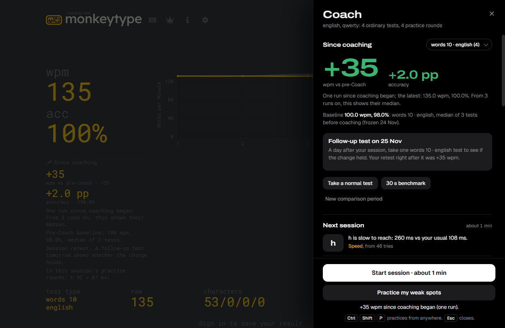
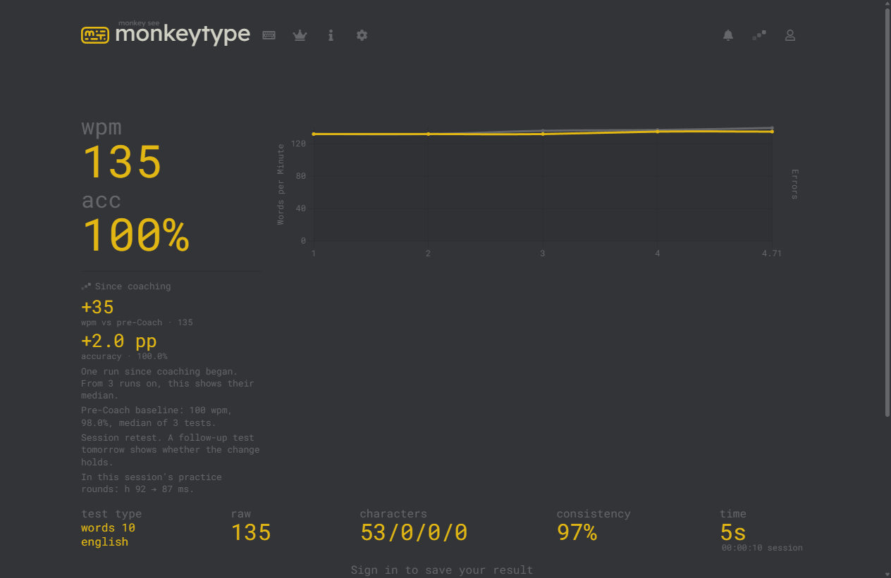
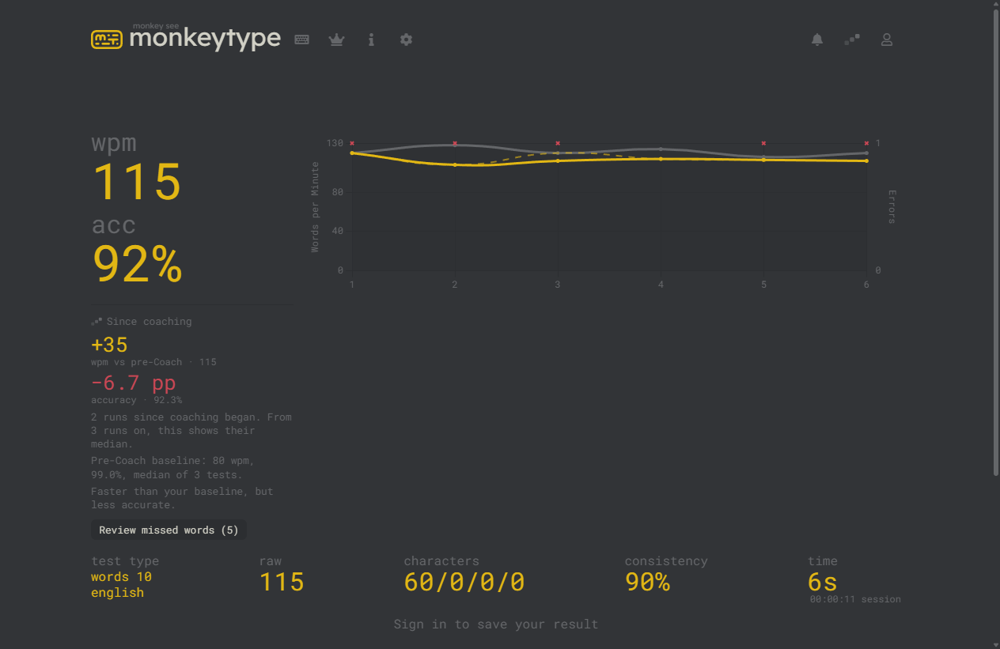
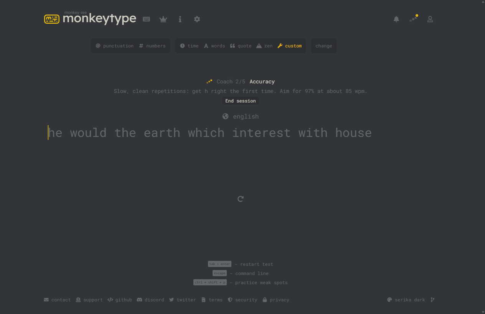
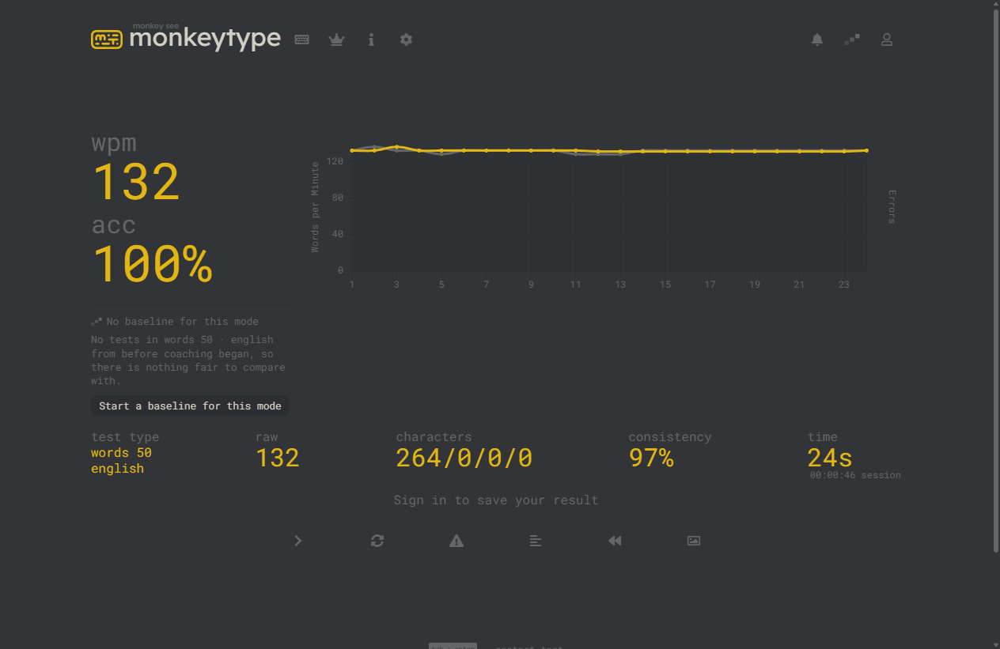

# Weakword Coach

Weakword Coach is a Windows Electron app that wraps the real [monkeytype.com](https://monkeytype.com). All credit for the typing test itself goes to Monkeytype's creator, **Miodec**, and its [open-source contributors](https://github.com/monkeytypegame/monkeytype/graphs/contributors); this is an independent add-on, not affiliated with them. Standard tests behave exactly as on the site and sync to your account as usual. On top of that it adds a coach. The coach learns what slows you down from your ordinary tests, trains it in short practice sessions that run in Monkeytype itself, and shows on every ordinary result whether your actual wpm has moved since coaching began.

Everything lives in one window. The Coach opens from a button next to Monkeytype's notification bell, and its progress row sits right under the result's wpm and accuracy. Ads are removed.

<p align="center">
  
</p>

## What it looks like

The screenshots are produced by the automated E2E suite: guest sessions, scripted typing and, where noted, fixture history in a throwaway profile. The numbers are not realistic.

| | |
|---|---|
|  |  |
| The row after a session's retest: signed deltas against the frozen pre-Coach baseline, the baseline itself and how many runs this is. | Speed up, accuracy down: both deltas are shown, with the trade-off spelled out. |
|  |  |
| A session step: the strip above the words says what to do and fades while you type. | A mode with no tests from before coaching gets its own baseline instead of an unfair comparison. |

More: [empty Coach](docs/screenshots/02-coach-empty.png), [sparse history](docs/screenshots/05-coach-sparse.png), [heatmap](docs/screenshots/06-coach-heatmap.png), [practice round result](docs/screenshots/08-drill-result.png), [negative delta](docs/screenshots/16-row-negative.png), [next-day follow-up](docs/screenshots/13-result-followup.png).

## Using it

1. Open Weakword Coach and take ordinary Monkeytype tests (time, words or quote) the way you always do.
2. Each result shows a Coach row under wpm and acc. Before you practice it reads "Baseline 1/3 complete", then 2/3, then "Baseline ready": your baseline is the median of your last 3 tests in that mode.
3. Click the Coach button (three climbing keycaps, right of the bell). Under "Next session" it lists 1 to 3 targets with the reason for each, for example "You miss p often: 27% of first tries (usually 3%)". Click **Start session · about 6 min**.
4. Type each practice round; its result says how the targets went. Press **Next: …** in the row (or Ctrl+Shift+P) for the next round. The last step is a normal retest in your usual mode.
5. The retest's row compares it with the baseline frozen at your first drill, for example `+5 wpm vs pre-Coach · +0.6 pp`. Every later ordinary test in that mode shows the same row, and after 3 runs it shows their median.
6. A day later the Coach button gets a dot ("follow-up test due"). One ordinary test then shows whether the change held.

**Practice my weak spots** in the panel (or Ctrl+Shift+P anywhere) runs a single one-minute round instead of a session. **Review missed words** on a result practices that test's missed and stalled words.

Ctrl+Shift+P belongs to the Coach inside the app. Monkeytype's command line stays on Esc, and the footer key tips say so.

## How it works

### Capture (`src/preload/`)

The Monkeytype window has a sandboxed preload that observes the page and never writes Monkeytype's storage or calls its API.

- A capture-phase `keydown` listener records each key typed into `#wordsInput`: the key, the expected character, the caret position, the word index and a monotonic `timeStamp`. Flags mark keys whose timing is not clean: auto-repeat, the first key after the window lost focus, and the first key after input the keydown stream cannot see (paste, IME composition, Ctrl+Backspace). Nothing is blocked; Monkeytype's own result stays the official one.
- When `#result` mounts, the preload reads the result screen's official record: wpm, raw, accuracy and consistency (exact values from `aria-label`), the "test type" lines (mode, language, punctuation, numbers, blind, lazy, funbox, difficulty, stop/delete on error) and the "other" lines (invalid, too short, repeated, afk, bailed out). It also reads a few scoring settings from Monkeytype's saved config, read-only. Letter `KeyboardEvent.code`s fingerprint the physical layout (QWERTY, Dvorak, Colemak, AZERTY, QWERTZ, Workman).
- Every attempt carries a random id, so storing a test is idempotent: a re-mounted result or a re-sent message cannot store it twice, and a restarted test is never stored.

### Classification and eligibility

- **normal**: time, words or quote from Monkeytype's own untargeted generator. **drill**: a custom text whose words exactly match a Coach prompt. **custom** and **zen** are stored but never used.
- Only eligible normal tests feed baselines, comparisons and the diagnosis. Monkeytype's own disqualifications (invalid, too short, repeated, afk, bailed out, failed) and an exact replay of the previous test's words make a test ineligible. Drills are never eligible.
- A **profile** keys comparisons: mode and length (quotes by length group), language, punctuation, numbers, scoring and assist modifiers, emulated layout, and physical layout. The word list's hash (corpus version) is stored per test; a changed list asks for a new baseline.

### Diagnosis (`src/shared/keystats.ts`, `diagnose.ts`)

- Per test, derived statistics (versioned, stored with the test, recomputed when the version changes) count **first attempts** only. A miss fixed with Backspace stays a miss. Timing uses press-to-press gaps between two correct first attempts with nothing in between: no pause over 2 s, and no repeat, blur or IME flag next to it.
- Patterns: letters, in-word bigrams and trigrams, words (error rate per occurrence, ms per letter, stalls), and boundaries: space, word starts, capitals (Shift), numbers and punctuation.
- The newest 30 eligible tests of the same **language and layout** are weighted toward recent runs (10-test half-life). Robust weighted medians give the timing. Sparse error rates and timings are smoothed toward your own baseline.
- **Impact** = how often the pattern occurs in the active corpus (Monkeytype draws uniformly from the language list) × the time it costs versus your baseline (slowness + excess first-attempt errors × 3.5 keystrokes) × reliability. A fast key missed 27% of the time therefore outranks a rare slow key; there is a unit test for exactly that.
- A pattern is **Learning** until it has 15 first attempts across 2 runs. Explanations are plain: "You miss p often", "th is slower than your other common pairs: 142 ms vs 108 ms".

### Sessions (`src/shared/planner.ts`, `generator.ts`, `practice-model.ts`)

- A default session is 5 to 7 minutes: warm-up (optional, switch in the panel), two slow clean accuracy rounds, three short speed bursts, a mixed round, then a normal retest in your benchmark mode. When your pace fades late in runs, the mixed part becomes two progressively longer runs.
- Targets are 1 to 3 high-impact patterns. A recovering pattern (its cost dropped below half of what it was) comes back on later days (1, 3, 7, 14 days).
- Prompts come from Monkeytype's GPL-3.0 word lists, downloaded on first use and cached, never bundled. Common real words come first, then varied placement (start, middle, end) and length, mixed with ordinary words. Each word appears at most twice per round, with wider lists as a fallback. Mixed rounds use fresh words, in sentences for punctuation profiles. Generation is seeded, so prompts are reproducible and stored with their ids.
- Pace prompts start from your own clean pace. Accuracy rounds ask for 85% of it at a 97% first-attempt floor. Two clean rounds raise the speed prompt 5%; a rough round lowers it.
- Drills run through Monkeytype's own custom-text dialog, then a page reload (see `docs/monkeytype-dom.md`, stale wordset). The retest switches mode, length, punctuation and numbers through the config bar, like a user would.

### Measured progress (`src/shared/progress.ts`)

- **Before.** For each profile, the median wpm and median accuracy of the 3 most recent eligible tests before the first drill of the comparison period, frozen at that drill. Earlier history is reused. A profile with fewer than 3 shows its sample count; one with none gets its own baseline on request ("Start a baseline for this mode", labelled with its date, never "pre-Coach").
- **After.** One run shows as one run. From 3 runs on, the row shows the median of the latest 3 and how many runs there have been since coaching began. Signed deltas show regressions too, and a speed gain with lower accuracy is called out.
- **Follow-up.** A session's retest schedules a follow-up 24 hours later; the next ordinary test in that mode after it shows the change against the retest.
- **Transfer by skill.** Trained patterns are compared on ordinary tests from before and since coaching began, for example "th 142 → 118 ms", and say "Learning" until both sides have enough evidence.
- The wording describes measured change since coaching began; it never claims the app caused it.
- "New comparison period" in the panel starts over: baselines are taken again at the period's first drill.

### Ads

The Monkeytype session blocks Playwire RAMP (`cdn.intergient.com`), which loads Monkeytype's ads, plus Google's ad hosts, the ad-blocker message, and the header-bidding and ID-sync hosts seen on the site (`src/main/adblock.ts`). CSS collapses the ad slots and the space they took. The merch-store banner is dismissed with its own close button, which Monkeytype remembers, because hiding it would leave the gap it pushes the page down by.

### Storage (`src/main/db.ts`)

SQLite in the app's profile (`%APPDATA%\weakword-coach\weakword.db`), schema version 2 (`PRAGMA user_version`). Version 1 databases from 0.1.x are migrated in place on first launch: kinds, eligibility and profiles are backfilled, old practice lists become prompts, and old tests adopt the first layout the app fingerprints. Tables: tests (with derived stats, profile, record, prompt and session ids), keystrokes, words, prompts, sessions (plan, step, results, follow-up), periods, baselines (frozen membership), pattern_state (practice model) and meta.

### Tuning

Every weight, threshold and practice default is in `src/shared/tuning.ts`: pause cut-off, minimum evidence, smoothing, error cost, weak-pattern margins, accuracy floor, pace steps, step durations, filler shares, review intervals, baseline size and follow-up delay.

## What it never does

- It does not modify Monkeytype's code, write its storage, call its API, read auth tokens, or post or alter results. It observes the DOM and clicks buttons like a user.
- No AI service and no telemetry. Everything runs offline except Monkeytype itself and the one-time word-list download.
- Drill scores never enter your baseline, comparisons or best scores. Monkeytype itself never ranks custom texts either.
- Fixture data from the test suite only ever goes into throwaway profiles.

## Setup

Requirements: Windows, and Node.js 22.12 or newer (Electron 45's tooling needs it).

```
npm install
```

## Run

```
npm start
```

This builds with esbuild and launches Electron with your real profile. If your shell exports `ELECTRON_RUN_AS_NODE` (VS Code's integrated terminal does), unset it first, or Electron will start as plain Node.

## Test

```
npm run typecheck
npm test            # vitest: keystats, diagnosis, generator, planner, practice model, progress, profiles, db + migration, coach service
npm run test:e2e    # builds, then runs the Playwright (_electron) specs against the live site
```

Run vitest from PowerShell or cmd: it fails from Git Bash's lowercase `c:\` working directory.

The E2E suite needs internet (live monkeytype.com, as a guest) and takes about 9 minutes. It launches the app with `WWC_TEST=1`. In that mode windows render off-screen without a taskbar entry or focus (`WWC_TEST_VISIBLE=1` shows them), and `WWC_USER_DATA` points to a throwaway profile, so tests never touch your data or login. Test-only knobs: `WWC_TUNING` (JSON override of the tuning) and `WWC_CLOCK_OFFSET_MS` (to reach a next-day follow-up). The suite regenerates `docs/screenshots/`.

## Build

```
npm run dist           # NSIS installer in release/
npm run test:packaged  # runs the packaged-app E2E spec against release/win-unpacked
```

The installer is not code-signed, so Windows SmartScreen will warn when you run it.

## When Monkeytype changes its markup

Symptoms: no Coach row on results, no Coach button, or a practice round failing with a message naming a step ("the custom text dialog did not open").

1. Selectors and labels live in `src/preload/selectors.ts`. Don't select on Tailwind classes.
2. `docs/monkeytype-dom.md` records the markup the app was verified against, including what the app adds to the page.
3. If the result screen changes shape, the row falls back to a card of its own beside the result instead of disappearing.
4. Re-run `test/e2e/launch.spec.ts` (header, ads, panel), `capture.spec.ts` (capture, record) and `practice.spec.ts` (custom text flow).

## Known limitations

- Layout emulation inside Monkeytype (its `layout` setting) changes which character a key produces, so tests typed with it are kept in their own profile and their per-key data may be off.
- Quote mode has no corpus frequencies: its diagnosis weights use observed frequencies.
- Practice rounds and the retest abandon a test in progress, and a practice round reloads the Monkeytype page.
- The retest can only set standard lengths (time 15/30/60/120, words 10/25/50/100, quote groups) and needs Monkeytype on the profile's language; otherwise it says what to switch.
- The first practice round needs internet to download the word lists; after that they are cached.
- Windows only, unsigned installer.

## Project layout

```
src/
  main/       Electron main: window and Coach view, IPC (main.ts), coach service (coach.ts), SQLite (db.ts),
              ad blocking (adblock.ts), word lists (wordlists.ts), payload validation (validate.ts)
  preload/    monkeytype.ts (capture, result record, IPC), recorder.ts, ui.ts (button, row, strip, key tips, ad CSS),
              inject.ts (custom text, test profiles), selectors.ts, coach.ts (panel bridge)
  shared/     pure logic: types, tuning, keystats, diagnose, corpus, profile, progress, planner, generator,
              practice-model, layout, util
  coach/      the Coach panel: index.html, coach.ts, trend.ts, coach.css
test/
  unit/       vitest specs
  e2e/        Playwright specs and helpers.ts (fixtures, composite screenshots)
  fixtures/   test data builders
docs/
  monkeytype-dom.md   Monkeytype markup reference
  screenshots/        images used in this README
```

## License and credits

Weakword Coach is released under the [MIT License](LICENSE).

**Monkeytype.** Everything you type into is [Monkeytype](https://monkeytype.com), created by **Miodec** and built by its community of contributors ([monkeytypegame/monkeytype](https://github.com/monkeytypegame/monkeytype), GPL-3.0). This project contains none of Monkeytype's source code. Its word lists, also GPL-3.0, are downloaded at runtime from monkeytype.com and kept in your own profile, never bundled or redistributed here. Weakword Coach is unaffiliated with, and not endorsed by, Monkeytype. If you enjoy it, support Monkeytype itself.

**Ideas.** The approach draws on keybr and Typing.com's adaptive practice, Amphetype, Dhakal et al. (CHI 2018) on inter-key timing, Crump & Logan (2010) on word-specific practice gains, and Baddeley & Longman (1978) on distributed practice. Weakword Coach is also unaffiliated with keybr.

Full details are in [NOTICE.md](NOTICE.md). The Coach panel's footer carries the same Monkeytype credit.
