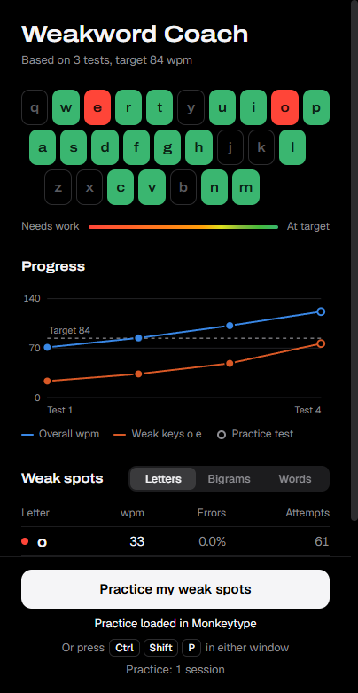
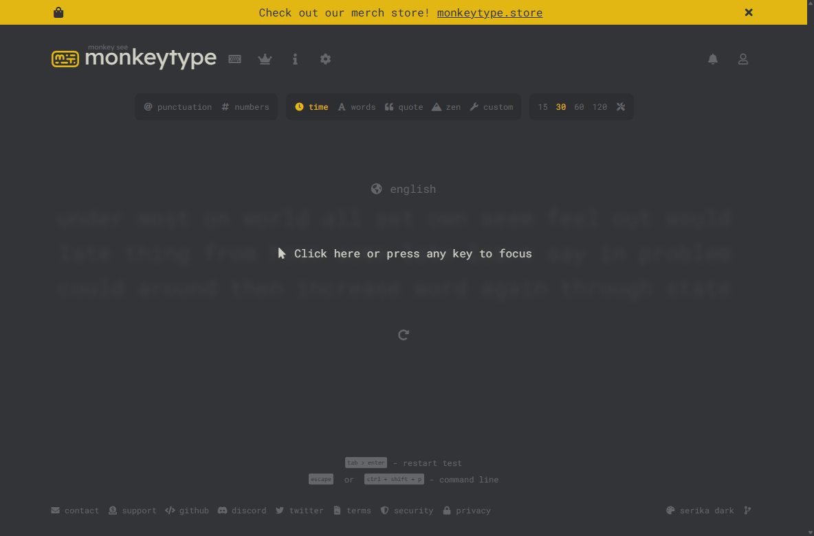
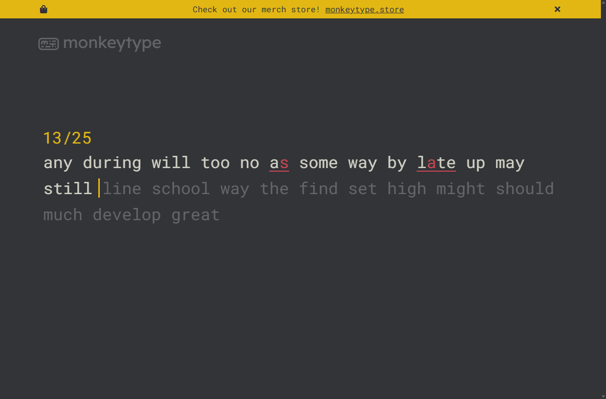
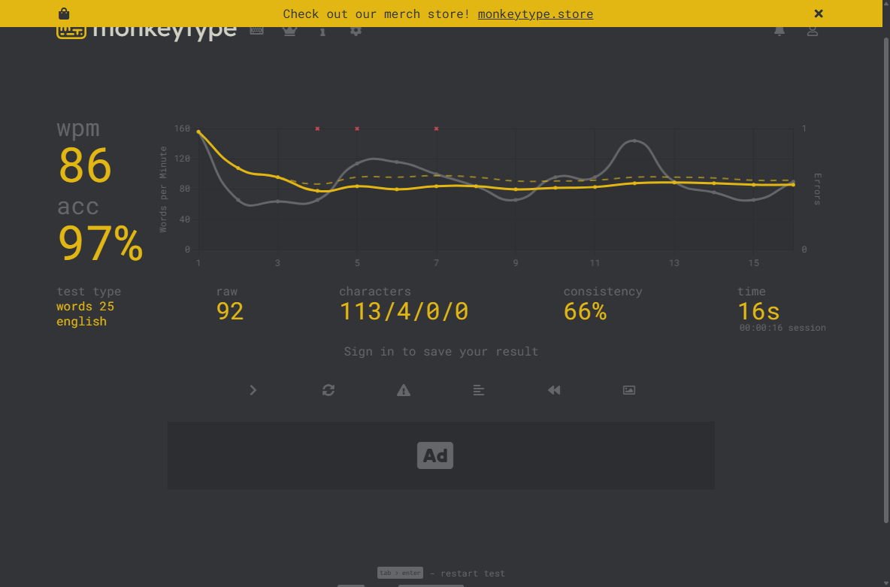
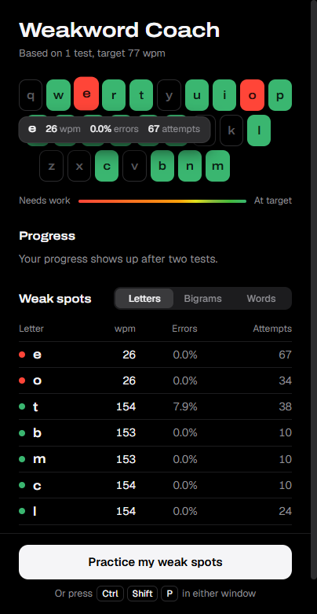
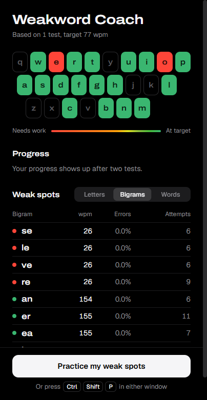
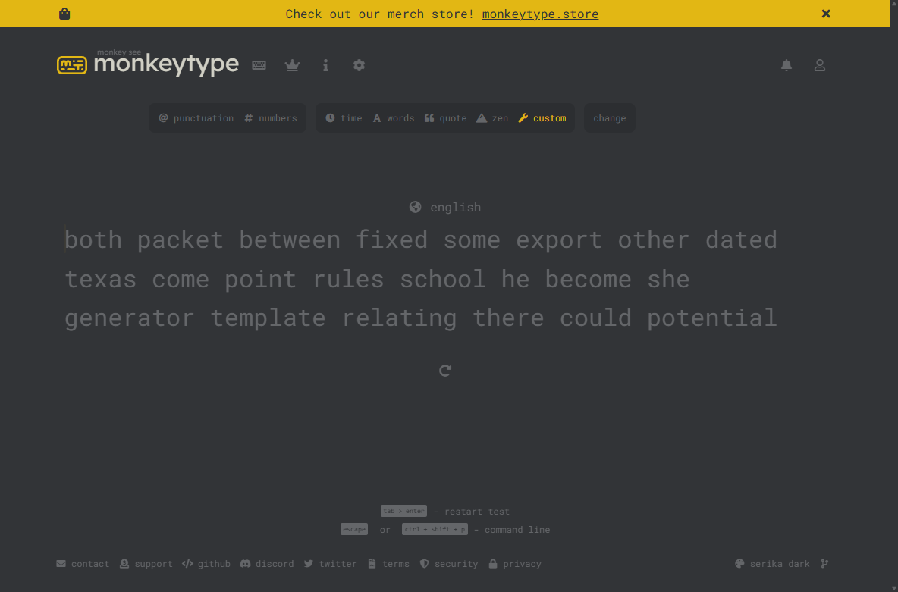
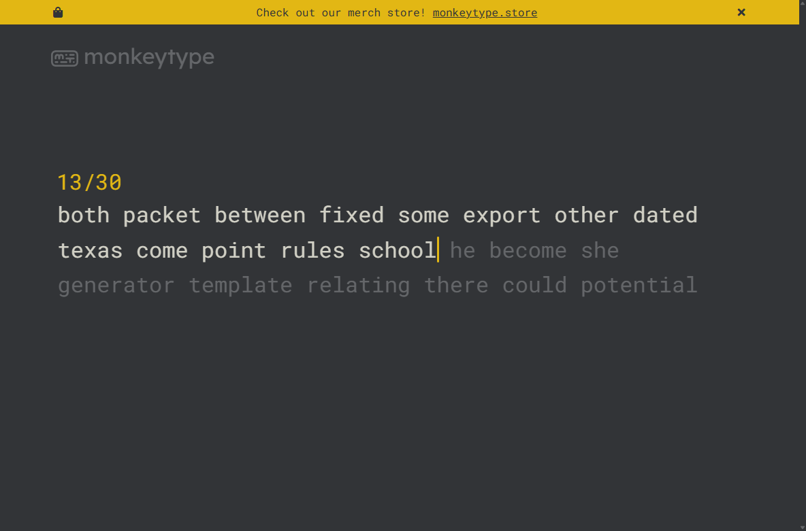
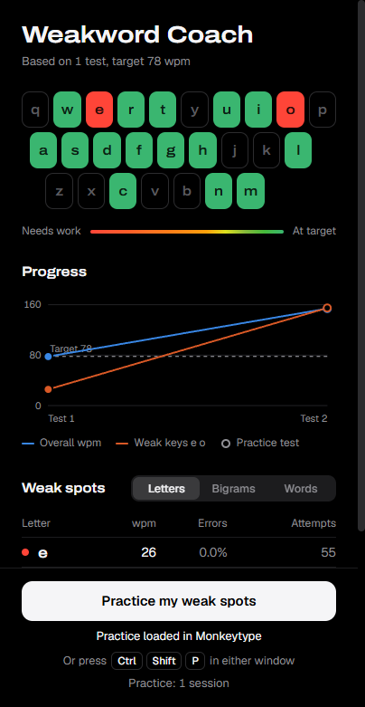
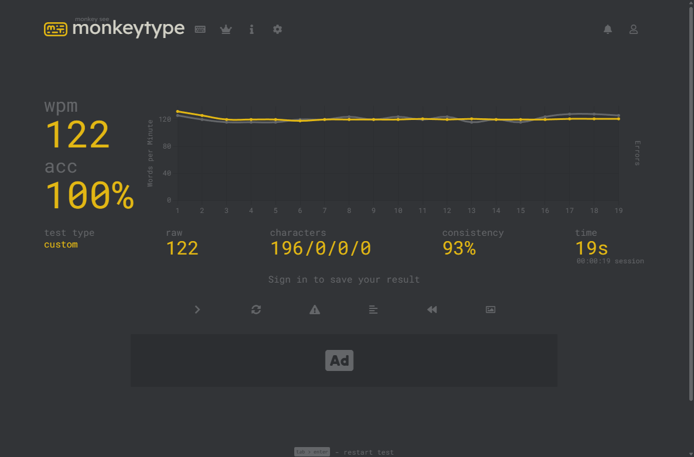

# Weakword Coach

Weakword Coach is a Windows Electron app that wraps the real [monkeytype.com](https://monkeytype.com), so standard tests behave exactly as on the site and sync to your account as usual. On top of that it adds keybr-style adaptive training. It captures per-keystroke data from your Monkeytype tests, finds your slowest and most error-prone letters, bigrams and words, and loads practice tests that target them into Monkeytype's Custom mode.

The app opens two windows: Monkeytype itself, and a narrow Coach window beside it with a keyboard heatmap, a progress chart and a table of weak spots.

<p align="center">
  
</p>

The Coach panel after three standard tests and one practice run. Red keys are the slowest or most error-prone relative to your target speed. The chart plots Monkeytype's wpm (blue) against your speed on the current weak keys (orange); hollow circles are practice tests.

## What it looks like

The screenshots below are produced by the automated E2E suite, so they come from guest sessions with scripted typing. The numbers (and the very even speeds) are not realistic.

**1. Launch.** Monkeytype loads as it does in a browser; the app does not change the page.



**2. Take a normal test.** Mid-test, and the result screen that ends it. The result screen appearing is the moment the test is saved locally.

<table>
  <tr>
    <td></td>
    <td></td>
  </tr>
  <tr>
    <td>Mid-test (13 of 25 words).</td>
    <td>Result screen: wpm, accuracy, raw, consistency are read from it.</td>
  </tr>
</table>

**3. See your weak spots.** The Coach window updates by itself when a test finishes. Hover or focus a key for its wpm, error rate and attempts; switch the table between Letters, Bigrams and Words.

<table>
  <tr>
    <td></td>
    <td></td>
  </tr>
  <tr>
    <td>Heatmap and Letters table, tooltip on <code>e</code>.</td>
    <td>Bigrams tab: letter pairs within a word, weakest first.</td>
  </tr>
</table>

**4. Practice.** "Practice my weak spots" (or Ctrl+Shift+P) builds a 30-word list around those spots and loads it into Monkeytype's Custom mode. Typing it is an ordinary Monkeytype test.

<table>
  <tr>
    <td></td>
    <td></td>
  </tr>
  <tr>
    <td>Practice loaded: custom mode, 30 words, every word contains a focus letter or bigram.</td>
    <td>Mid-way through the practice test.</td>
  </tr>
</table>

**5. Results.** The practice test is recognised and stored separately, so it does not skew your standard stats. The Coach shows it as a hollow point on the chart and counts the session.

<table>
  <tr>
    <td></td>
    <td></td>
  </tr>
  <tr>
    <td>Coach after the practice test ("Practice: 1 session").</td>
    <td>Monkeytype's result screen for the practice test.</td>
  </tr>
</table>

## How it works

### Capture

The Monkeytype window has a sandboxed preload (`src/preload/monkeytype.ts`) that only observes the page while you take tests.

- A capture-phase `keydown` listener on `window` sees every key typed into Monkeytype's `#wordsInput`. A key counts only if no modifier is held (other than Shift), no modal dialog is open and the result screen is not showing.
- A `MutationObserver` records each word's target text from the DOM when it appears (Monkeytype removes old words as you scroll) and notices when the result screen (`#result`) is mounted.
- The "expected" character for each key comes from those recorded words plus the recorder's own word counter (`src/preload/recorder.ts`). The DOM's active word can lag a word behind at fast typing, so the recorder follows the keys it sees and re-syncs to the DOM only after 50 ms of quiet. Backspace is tracked, including stepping back into a word that was committed wrong.
- Each stored keystroke has: time since the first key, the key, the expected character (or null), whether it was correct, and the word index.
- When the result screen appears, the finished test (words, keystrokes, mode, language, and wpm / raw / accuracy / consistency read from the result screen) is sent to the main process and stored in SQLite (`src/main/db.ts`). A test abandoned with a restart, or one with no keystrokes, is never stored. Word 0 appearing means a fresh wordset, which discards the old attempt.

### Analysis

`src/shared/analysis.ts` is pure and unit-tested. It uses the newest 50 tests of a source (standard or practice) and only a-z letters.

- Timed samples: a keystroke yields a speed sample only when it and the previous keystroke were both correct and the gap is greater than 0 and at most `PAUSE_MS` (2000 ms). Longer gaps are treated as pauses, not speed.
- Per letter: attempts, errors, and the median ms per char over its timed samples.
- Per bigram: two consecutive correct letters in the same word, counted against the second key. An error is a wrong second key; the sample is the gap between the two correct keys.
- Per word (3+ letters): ms per char from the key before the word (normally the previous Space) to its last key, skipped as a sample if any gap in the word exceeds `PAUSE_MS`. Error rate is errors divided by letters typed.
- Target speed: the median wpm of your newest 10 standard tests, rounded and clamped to 20..250 (40 if there are none). `targetMs = 12000 / targetWpm`.
- Per item: `weakness = (msPerChar / targetMs) * (1 + 4 * errorRate)` and `confidence = 1 / weakness`. An item with no timed samples is treated as `2 * targetMs`. Items are ranked by weakness, and confidence below 1 means "below target". The heatmap colour comes from confidence.
- Minimum attempts before an item is listed: 10 for letters, 6 for bigrams, 2 for words.

### Practice generator

`src/shared/generator.ts` is pure and deterministic for a given seed (the app picks a random seed each time).

- Focus: up to 4 letters with confidence below 1 (the 2 weakest if fewer than 2 are below), up to 4 weak bigrams, and up to 3 weak words that contain a focus letter or bigram. With no data it refuses: "Not enough data yet: finish a few Monkeytype tests first."
- Candidates come from Monkeytype's English 5k list (lowercase a-z, 2-10 letters). Every candidate contains a focus letter or bigram, so every practice word exercises at least one weak spot.
- Weighting: a word's score is the sum of the weakness of the focus letters it contains plus 1.5 times the weakness of the focus bigrams it contains, divided by `1 + rank / 1000` (so common words are favoured). No word is drawn more than twice unless the pool is too small.
- Composition: first one word for any focus item the focus words do not already cover, then the focus words, then a "common word" share of 25% drawn from the 200 most common English words that contain a focus item, then weighted candidates up to the default length of 30 words.
- The list is shuffled with a seeded PRNG (mulberry32) and identical neighbours are separated.

### Injection

The Monkeytype preload loads the words by driving Monkeytype's own UI the way a user would (`src/preload/inject.ts`): leave the result screen (or abandon a running test) with Monkeytype's restart button, wait for the config bar to be usable, click "change" in the test config bar, pick the "simple" mode (words once each, in order), put the words in the custom text box, fire an `input` event, and click "ok". Then the main process reloads the page.

The reload is deliberate. Monkeytype has a stale-wordset behaviour: a custom text longer than the first custom wordset generated in the page session shows only that many words and then repeats them. A reload keeps the custom text and shows all of it (details in `docs/monkeytype-dom.md`).

### Practice tagging

The list is stored in `practice_sessions` once it has been loaded. When a custom-mode test ends and its words exactly equal one of the last 50 stored practice sessions, it is stored with `source = 'practice'` and linked to that session. Everything else is `source = 'standard'`. The heatmap, tables and the practice generator use standard tests only; practice tests are analysed separately and appear on the progress chart.

## What it never does

- It does not modify Monkeytype's source, call Monkeytype's API, read or store auth tokens, or post or alter your results. It only observes the DOM and clicks buttons like a user.
- Your data stays on your machine. Tests and keystrokes live in a SQLite file at `%APPDATA%\weakword-coach\weakword.db` (Electron's `userData` folder; the same for `npm start` and the installed app). Monkeytype's login session is stored alongside it.
- The one extra network request is the download of Monkeytype's English word lists (`english.json` and `english_5k.json`) from its GitHub repository on your first practice. They are cached in a `wordlists` folder next to the database. They are GPL-3.0 data, so they are not bundled with the app.
- Logging in to Monkeytype is done on monkeytype.com itself (Google and GitHub sign-in popups are allowed). Your login lives in the app's own persistent browser session and is not shared with your regular browser.

## Setup

Requirements: Windows, and Node.js 22.12 or newer (Electron 45's tooling needs it).

```
npm install
```

`package.json` already has `allowScripts` approvals for `electron` and `esbuild`, so their install scripts run under npm's script allow-list.

## Run

```
npm start
```

This builds with esbuild and launches Electron. If your shell exports `ELECTRON_RUN_AS_NODE` (VS Code's integrated terminal does), unset it first, or Electron will start as plain Node.

## Usage

1. Open the app. Two windows appear: Monkeytype and the Coach.
2. Log in to Monkeytype if you want your results saved to your account. This is optional; practice and the Coach work as a guest too.
3. Take normal tests. The Coach panel updates when each one finishes. It needs a few tests before letters, bigrams and words show up.
4. Press "Practice my weak spots" in the Coach, or press Ctrl+Shift+P in either window. The practice test loads into Monkeytype's Custom mode.

Ctrl+Shift+P shadows Monkeytype's own command-line shortcut inside the app. Esc still opens the command line. Starting a practice run abandons a test that is in progress.

## Test

```
npm run typecheck
npm test            # vitest unit tests: analysis, generator, recorder, db, practice
npm run test:e2e    # builds, then runs the Playwright (_electron) specs against the real site
```

The E2E suite needs internet access (it uses the live monkeytype.com as a guest) and takes several minutes. It launches the app with `WWC_TEST=1`, which shows windows without taking focus, and `WWC_USER_DATA=<temp dir>`, a throwaway profile, so it does not touch your real data or login. It also regenerates the screenshots in `docs/screenshots/`.

## Build

```
npm run dist           # NSIS installer in release/
npm run test:packaged  # runs the packaged-app E2E spec against release/win-unpacked
```

`test:packaged` needs `npm run dist` first. The installer is not code-signed, so Windows SmartScreen will warn when you run it.

## When Monkeytype changes its markup

Monkeytype is a moving target. Symptoms:

- The Coach stops updating after tests, or shows odd numbers (capture is not seeing the page).
- "Practice my weak spots" fails with a message naming a step, such as "Monkeytype: the custom text dialog did not open" or "the test settings stayed disabled".

How to fix it:

1. Every selector and button label the app and its tests use lives in `src/preload/selectors.ts` (`SEL` for selectors, `LABEL` for visible text). Fix them there only; don't select on Tailwind classes.
2. `docs/monkeytype-dom.md` describes the markup the app was verified against (inspected 2026-11-24), including the test lifecycle (idle, start, end, restart) and the custom text flow. Update it as you learn.
3. Inspect the live markup in the Monkeytype window with DevTools. The app keeps Electron's default menu (hidden; press Alt), which should include View, Toggle Developer Tools (Ctrl+Shift+I). If that is not available in your build, inspect monkeytype.com in Chrome; the markup is the same.
4. Re-run the specs that exercise the selectors: `test/e2e/capture.spec.ts` covers capture and the result screen (words, `#wordsInput`, result stats, test mode), and `test/e2e/practice.spec.ts` covers the custom text dialog and the reload. For example:

```
npx playwright test test/e2e/capture.spec.ts test/e2e/practice.spec.ts
```

(The `npm run test:e2e` script builds first; if you run `npx playwright test` directly, run `npm run build` first.)

## Known limitations

- The heatmap shows the QWERTY letters a-z only. Digits, punctuation and other layouts are not analysed (keys outside a-z are ignored).
- Practice lists are English only, built from Monkeytype's English word lists. Analysis does not filter by language or mode, so tests in other languages or modes are mixed in.
- Analysis uses the newest 50 tests per source.
- Starting a practice run abandons a test in progress and reloads the Monkeytype page.
- The first practice run needs internet to download the word lists; after that they are cached.
- Windows only: the build config targets a Windows x64 NSIS installer, and nothing here has been tried on macOS or Linux.
- The installer is unsigned.
- Capture depends on Monkeytype's markup and default settings. A different layout, input method (IME), or settings that change how letters render may reduce accuracy.
- A test recognised as practice must match a stored practice list exactly; editing the custom text yourself makes it count as a standard test.

## Project layout

```
src/
  main/       Electron main process: windows, IPC, SQLite (db.ts), word-list download (wordlists.ts)
  preload/    monkeytype.ts (capture + inject entry), recorder.ts, inject.ts, selectors.ts, coach.ts (bridge)
  shared/     analysis.ts, generator.ts, types.ts: pure logic, no Electron
  coach/      The Coach window UI: index.html, coach.ts, trend.ts, coach.css
test/
  unit/       vitest specs for analysis, generator, recorder, db, practice
  e2e/        Playwright specs (launch, capture, coach, practice, trend, packaged) and helpers.ts
  fixtures/   Shared test data builders
docs/
  monkeytype-dom.md   Monkeytype markup reference
  screenshots/        Images used in this README
scripts/test-packaged.mjs
build.mjs             esbuild bundling
```

## License and credits

No license has been chosen yet.

Weakword Coach is unaffiliated with Monkeytype and keybr. keybr's approach inspired the idea; no keybr code is used.
